# opengl-test

This repo contains all shader that I made reading [The Book of Shaders](https://thebookofshaders.com/) with a very handy program, I wrote for that.

## Features

This program can:

- Log shaders and shader program compilation with errors, space presses with shader switch.
- Hot reload shaders if they were updated in runtime.
- Add more shaders in runtime if more shaders were added in `./resources/fragment/` folder (sometimes doesn't work for some reason).
- Switch between shaders with `Space` key, toggle shader window resolution between 640x640 and 320x320 with `R` key.

## Build

1. Enter nix-shell with `nix-shell` or install dependencies:
    ```sh
    # Build systems
    cmake ninja \
    # OpenGL
    libGL \
    # If you use Wayland
    wayland-scanner wayland gtk3 libxkbcommon pkg-config \
    # If you use X11
    libX11 libXcursor libXi libXinerama libXrandr
    ```

2. Build:
    ```sh
    cmake -B build -G Ninja && cmake --build build
    ```

3. Run:
    ```sh
    build/game
    ```

## Shaders

### Algorithmic drawing

[Link to the book chapter](https://thebookofshaders.com/05/)

01-algorithm.frag:

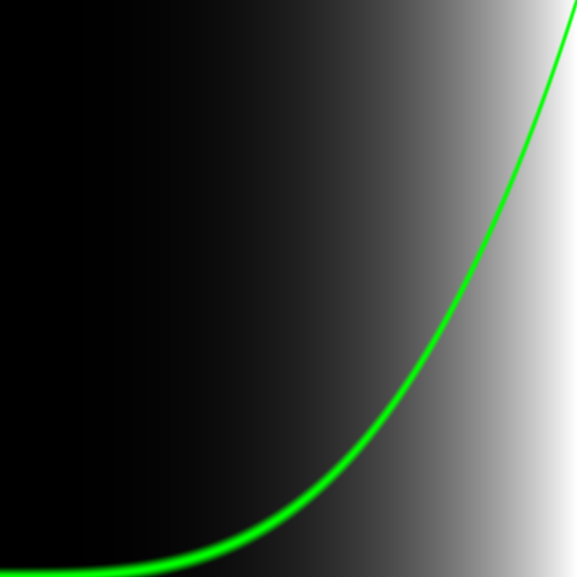

02-algorithm.frag:

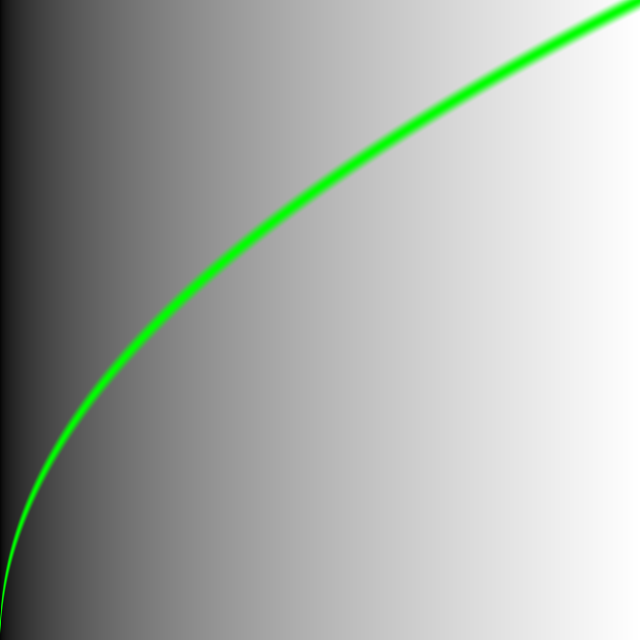

03-step.frag:


04-smoothstep.frag:

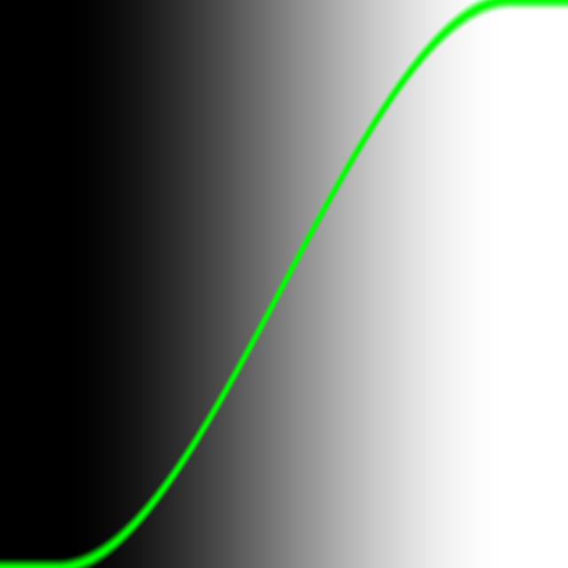

05-sin.frag:

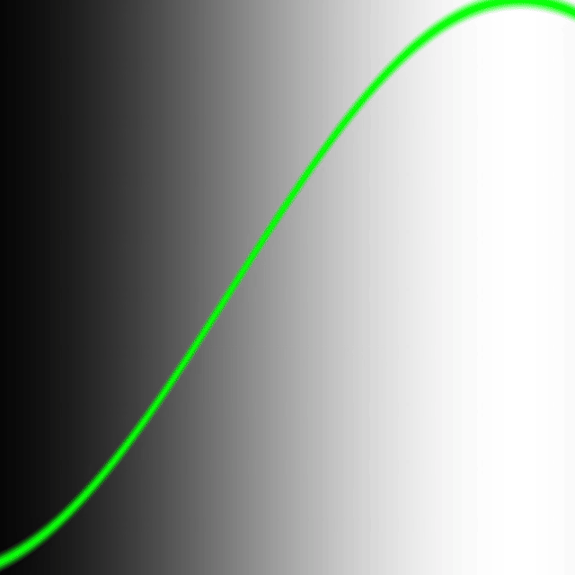

06-mod.frag:

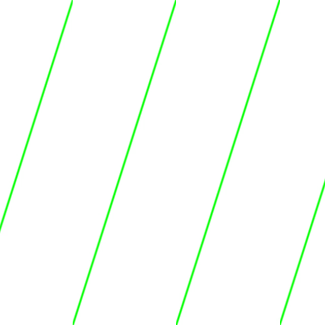


### Colors

[Link to the book chapter](https://thebookofshaders.com/06/)

07-color1.frag:

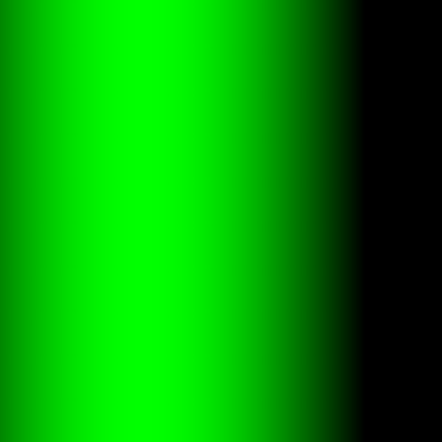

08-color2.frag:


09-color3.frag:

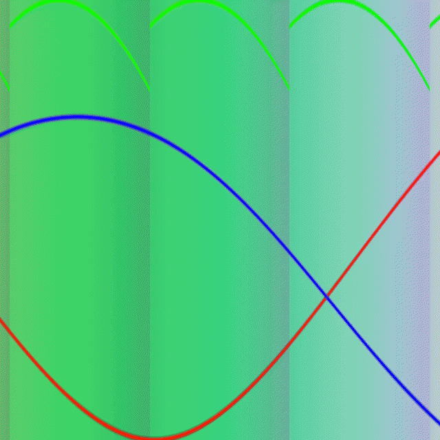

10-hsb.frag:

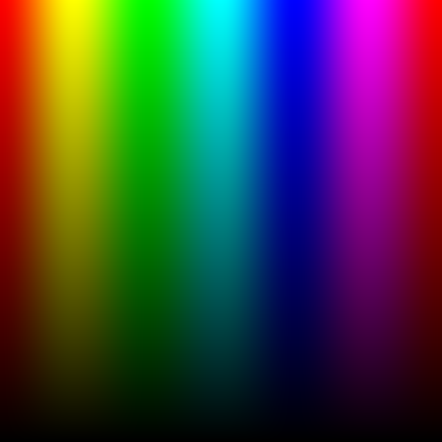

11-hsb-polar.frag:

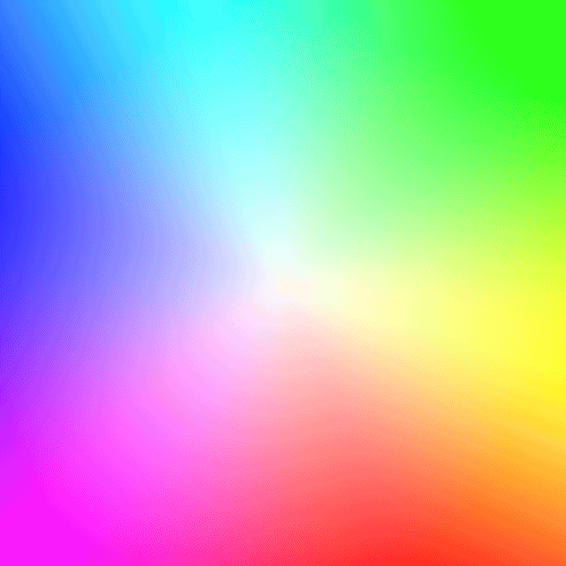


### Shapes

[Link to the book chapter](https://thebookofshaders.com/07/)

12-shapes1.frag:

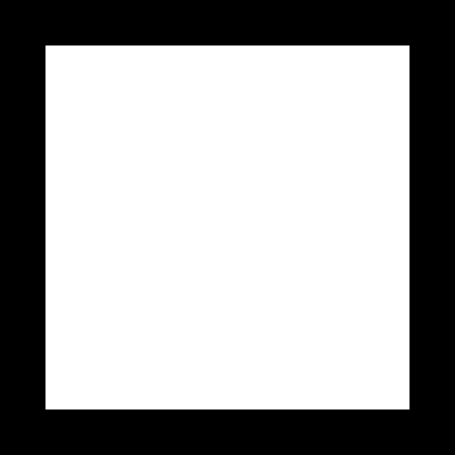

13-shapes2.frag:


14-circle.frag:

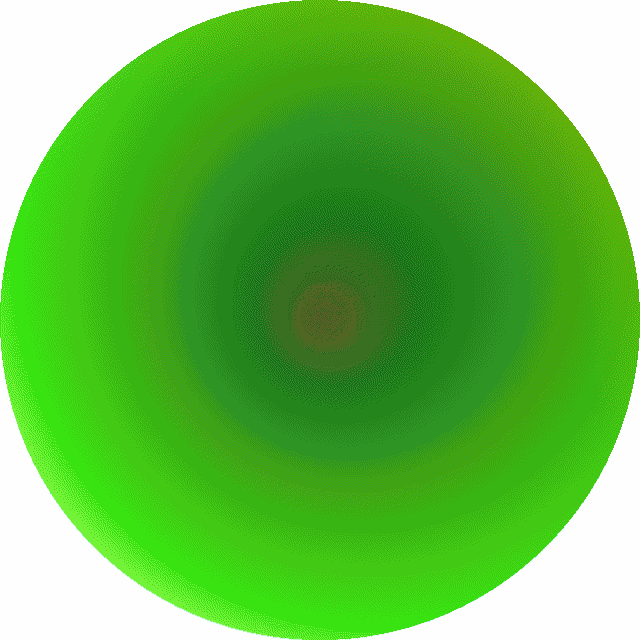

15-shapes3.frag:

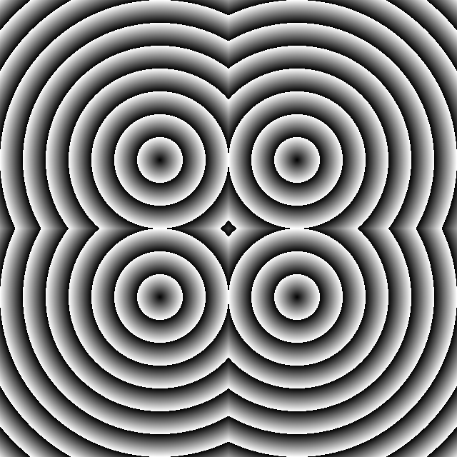

16-polar-shapes.frag:

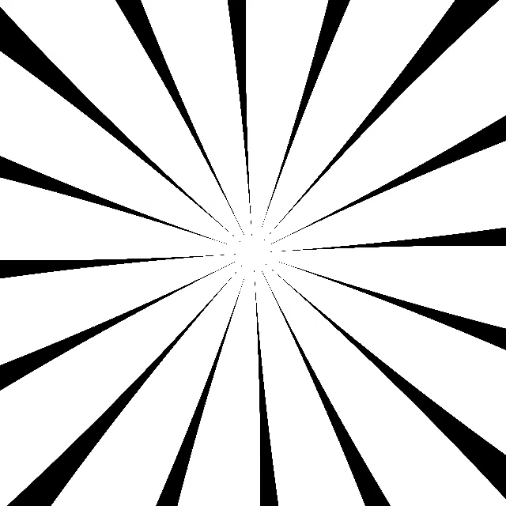

17-polar-shapes2.frag:


### 2d matrices

[Link to the book chapter](https://thebookofshaders.com/08/)

18-2d-matrices.frag:

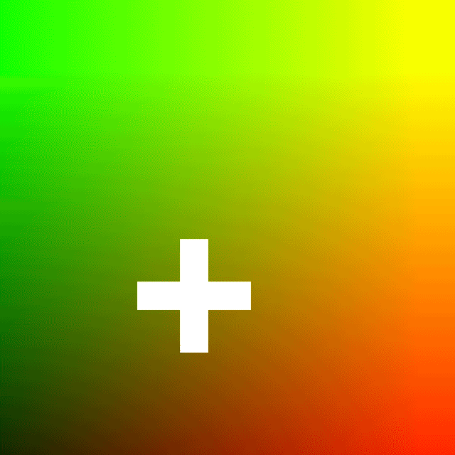

19-rotation.frag:


20-scale.frag:


### Patterns

[Link to the book chapter](https://thebookofshaders.com/09/)

21-patterns.frag:

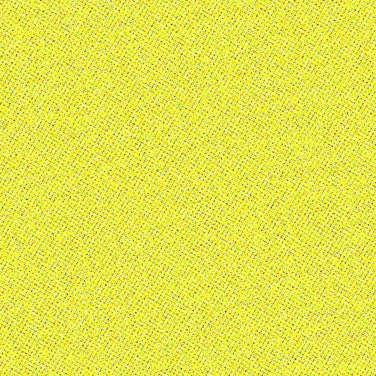

22-patterns2.frag:


23-bricks.frag:

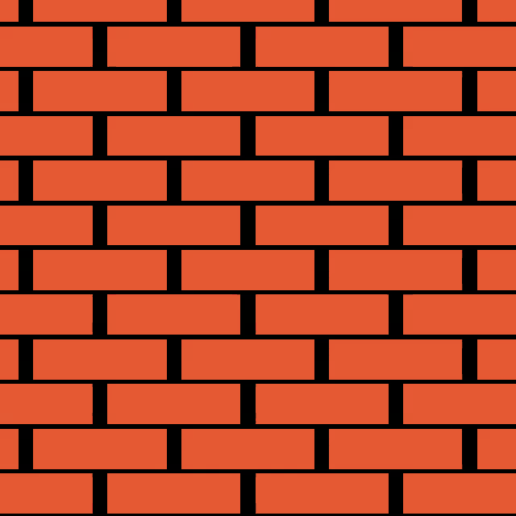

24-tiles.frag:

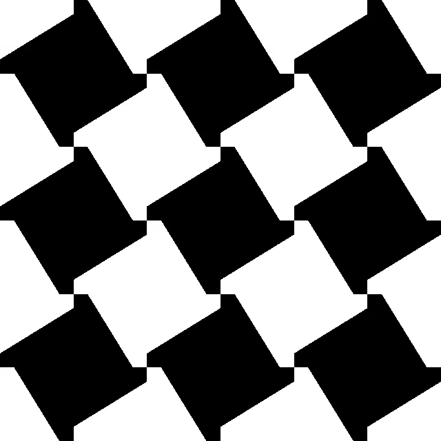


### Generative designs

[Link to the book chapter](https://thebookofshaders.com/10/)

25-random.frag:

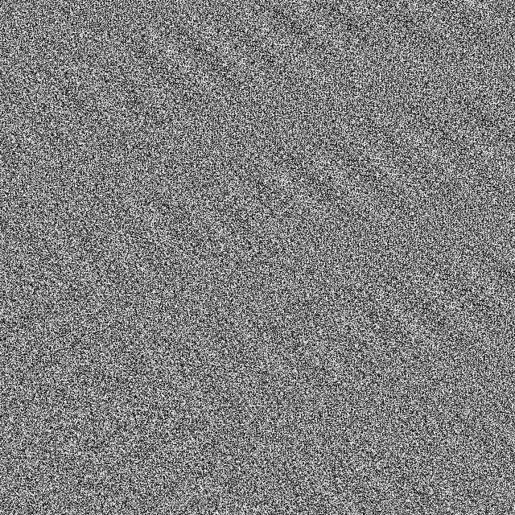

26-random2.frag:

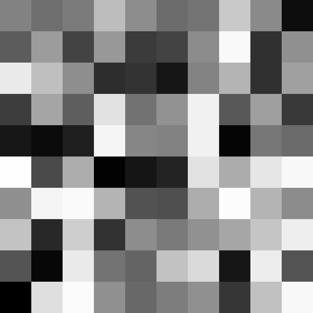

27-random3.frag:


### Noise

[Link to the book chapter](https://thebookofshaders.com/11/)

28-noise.frag:

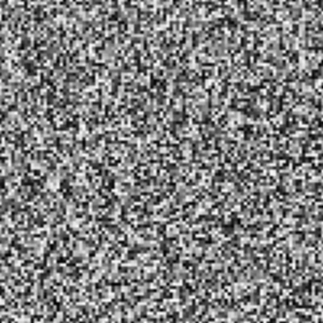

29-noise2.frag:

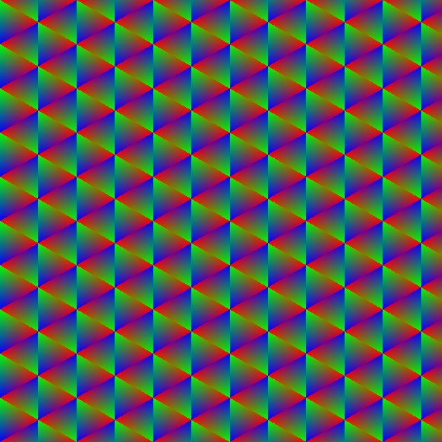


### Cellular noise

[Link to the book chapter](https://thebookofshaders.com/12/)

30-mouse.frag:

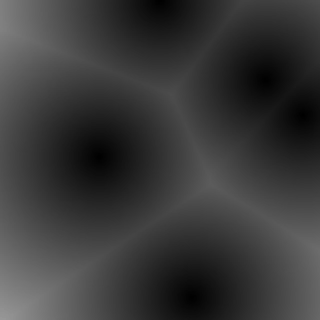
